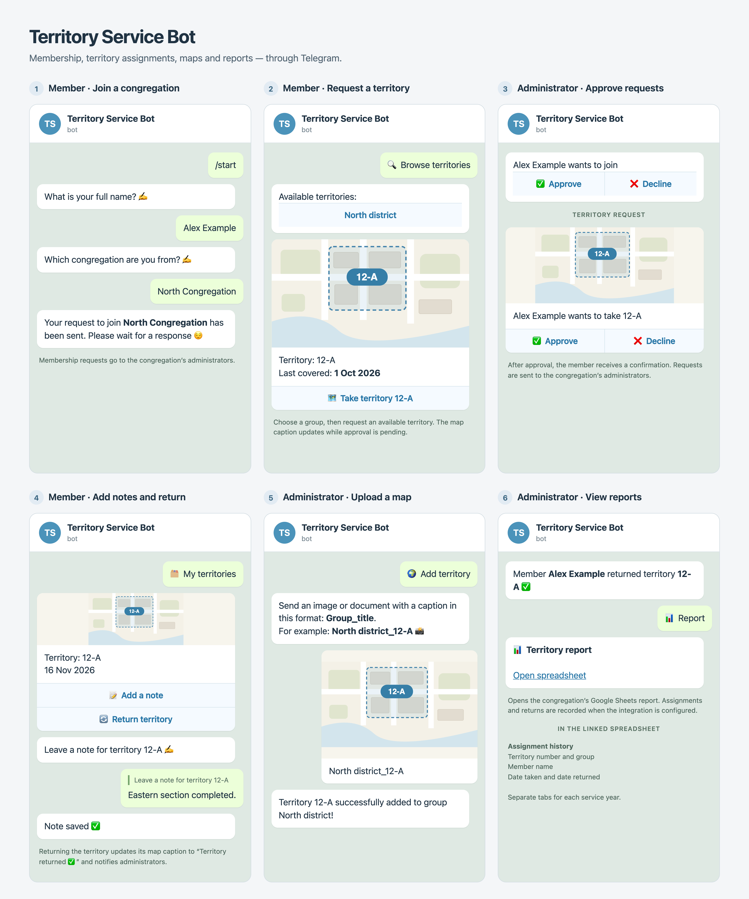
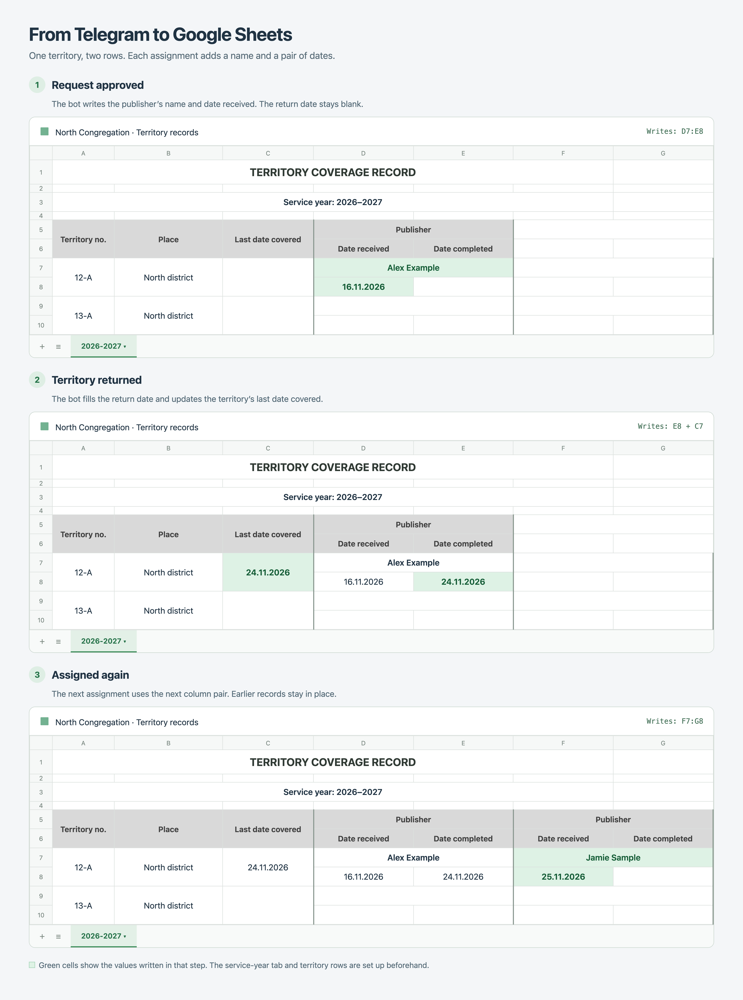

# Territory Service Bot

Telegram bot for managing territory assignments in congregations of Jehovah's Witnesses in Ukraine. A personal volunteer project.



## Features

- Request and return territories through Telegram
- Admin approval for membership and territory requests
- Territory maps, documents and notes
- Optional assignment reports in Google Sheets

Built with Go, PostgreSQL and the Telegram and Google Sheets APIs. Deployed on Google Cloud Run.

## Google Sheets

Approvals add a name and date; returns fill the completion date. Later assignments keep the earlier history. The service-year tab and territory rows must be set up first.



## Development

See [setup instructions](api/README.md).

```sh
cd api
go build ./cmd/...
go test -race ./...
```

## Privacy and security

Some access checks still need fixes before new deployments with real user data. Keep residents' personal details out of notes, and real user data and credentials out of issues.

## License

[MIT](LICENSE)
